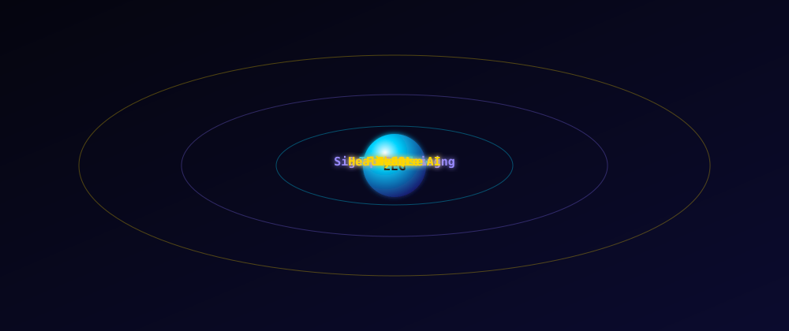
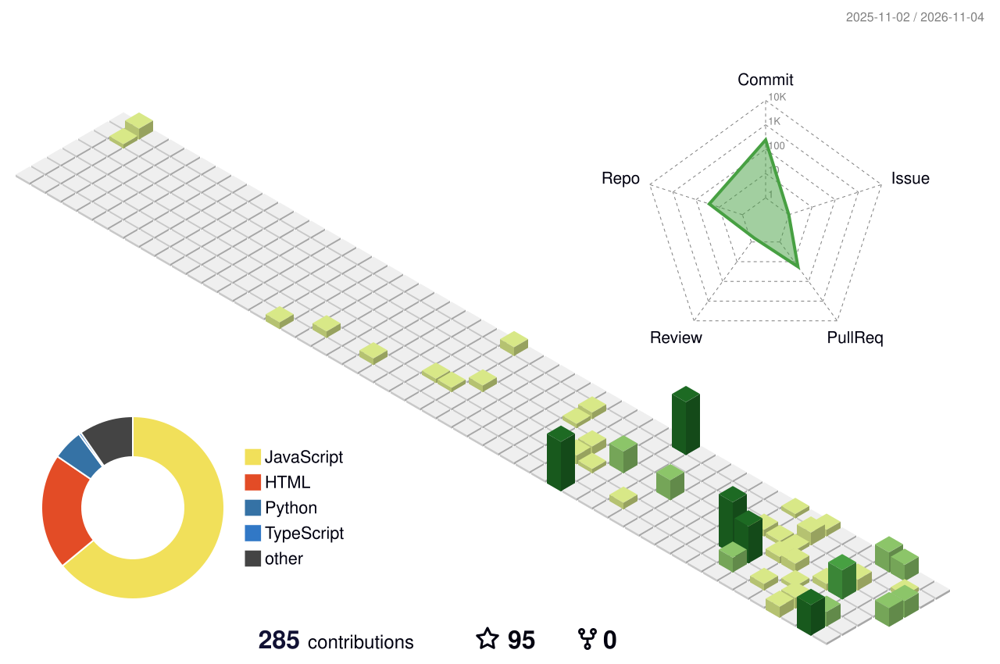

<div align="center">




<br/>

[](https://github.com/Devakumar-A)
[](https://github.com/Devakumar-A?tab=followers)
[](https://github.com/Devakumar-A?tab=repositories)

</div>

---

## About

I am **Devakumar A**, a B.Tech Computer Science student at **Rajiv Gandhi College of Engineering and Technology (RGCET), Puducherry, India**. My research sits at the intersection of **EEG signal processing, brain-computer interfaces (BCI) and deep learning**, applied to healthcare: emotion recognition, pain assessment and communication aids for paralyzed patients.

I also build full-stack products and serve as **President of the Mathoria Mathematics Club**.

```python
class Devakumar:
    name       = "Devakumar A"
    location   = "Puducherry, India"
    studying   = "B.Tech CSE @ RGCET"
    research   = ["EEG Signal Processing", "Brain-Computer Interfaces",
                  "Emotion & Pain Recognition", "Healthcare AI"]
    leads      = "Mathoria Mathematics Club (President)"
    mission    = "Building AI systems that give voice to the voiceless"
```

<div align="center">

</div>

---

## Recognition

<div align="center">

| | | | |
|:-:|:-:|:-:|:-:|
| [](#recognition) | [](#recognition) | [](#research) | [](#recognition) |
| **Deep Learning**<br/><sub>Top Rank</sub> | **Python for Data Science**<br/><sub>National certification</sub> | **Research Publication**<br/><sub>AI and healthcare</sub> | **Mathematics Club**<br/><sub>RGCET, Puducherry</sub> |

</div>

---

## Research

### Deep Learning-Based EEG Communication Aid for Paralyzed Patients

<div align="center">

| | |
|:---|:---|
| **Author** | Devakumar A, RGCET, Puducherry |
| **Venue** | Scopus indexed journal |
| **Status** | Published |

</div>

| Domain | Contribution |
|:---|:---|
| Brain-Computer Interface | Real-time communication framework for paralyzed patients |
| EEG Signal Processing | Multi-channel brainwave feature extraction pipeline |
| Deep Learning | Multi-task classification architecture |
| Emotion Detection | Automated emotional state recognition from EEG |
| Pain Monitoring | Quantitative pain-level estimation |
| Healthcare AI | End-to-end assistive technology |

<div align="center">

`EEG` `BCI` `Deep Learning` `Emotion Recognition` `Pain Assessment` `Healthcare AI`

</div>

---

## Projects

<table>
<tr>
<td width="50%" valign="top">

### Emotion Recognition via EEG
Decodes emotional states from raw brainwave signals. The core engine behind my Scopus publication.


</td>
<td width="50%" valign="top">

### Stock Price Prediction Engine
Forecasts market trends with LSTM networks and time-series analysis.


</td>
</tr>
<tr>
<td width="50%" valign="top">

### Automated Library Management System
Full-stack platform for managing educational resources with real-time tracking and cataloguing.


</td>
<td width="50%" valign="top">

### Mathoria Club Official Website
Club portal with event management, leaderboards and member engagement.


</td>
</tr>
</table>

---

## Tech Stack

<div align="center">


</div>

---

## 3D Contribution Graph

<div align="center">
<picture>
  <source media="(prefers-color-scheme: dark)" srcset="profile-3d-contrib/profile-night-view.svg"/>
  
</picture>
</div>

<div align="center">
<picture>
  <source media="(prefers-color-scheme: dark)" srcset="https://raw.githubusercontent.com/Devakumar-A/Devakumar-A/output/github-snake-dark.svg"/>
  
</picture>
</div>

---

## GitHub Stats

<div align="center">


</div>

---

## Connect

<div align="center">

[](https://www.linkedin.com/in/devakumar-a-129561305/)
[](mailto:devak9391@gmail.com)
[](https://github.com/Devakumar-A)

**Open to:** research collaborations, internships, AI/ML projects, paper co-authorship

<br/>

> *"I don't just study AI. I use it to give voice to those who've lost theirs."*


<sub>Devakumar A · AI researcher · EEG deep learning · brain-computer interface · healthcare AI · Scopus author · full stack developer · RGCET Puducherry, India</sub>

</div>
